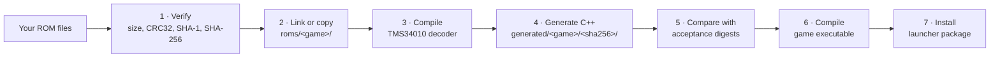

<p align="center">
  
</p>

<p align="center">
  <strong>Static recompilation of 1990s TMS34010 arcade boards into native C++ for Windows.</strong><br>
  Y-Unit · T-Unit · Wolf Unit, with their sound hardware. No emulator. No game files.
</p>

<p align="center">
  <a href="LICENSE"></a>
  
  
  
  
</p>

<p align="center">
  <a href="https://recomplauncher.com"><picture><source media="(prefers-color-scheme: dark)" srcset="https://recomplauncher.com/assets/press/launcher/badge-light.svg"></picture></a>
</p>

<p align="center">
  <a href="#quick-start">Quick start</a> ·
  <a href="#features">Features</a> ·
  <a href="#compatibility">Compatibility</a> ·
  <a href="#the-app-triunitexe">The app</a> ·
  <a href="#build-a-game-from-the-command-line">Command line</a> ·
  <a href="#recomplauncher">RecompLauncher</a> ·
  <a href="#roadmap">Roadmap</a> ·
  <a href="#legal-notice">Legal</a>
</p>

<p align="center">
  
</p>

## Overview

TriUnit Recomp is a set of tools that turns the program of a 1990s arcade
board into native C++ for Windows. It covers three board families built on the
**TMS34010** graphics processor (Y-Unit, T-Unit and Wolf Unit), with their sound
hardware (**ADSP-2105 DCS**, **6809** sound board, **YM2151**, **OKI ADPCM**).

> [!IMPORTANT]
> The repository contains **only tools**: decoders, generators, hardware models
> and a launcher. It contains **no game files**. The game's C++ is generated on
> your machine, from ROM files you own, by a static recompilation done locally
> from your ROM.

| | |
|---|---|
| ⚙️ **Native, not emulated** | Each game's program becomes C++ compiled into a Windows executable on your machine. The board's hardware is modelled in the project's own C++. |
| 🕹️ **Two editions per game** | *Arcade Original* keeps the arcade's image and audio; *Remastered* adds presentation options. Rules, timing, voices and effects are the same in both. |
| 🖥️ **Modern display** | Widescreen 16:9 drawn by the game itself, CRT and scanline presets, ScaleFX, CAS, SMAA, VRR, high refresh and HDR10. |
| 🎮 **Made to be played** | Save states, run-ahead (one frame less input lag), training mode with the game's own hit boxes, arcade sticks, your own music. |
| 🔒 **Local and verifiable** | Nothing is downloaded. Every ROM file is checked against a manifest, and the generated output is checked against pinned digests. |

## Quick start


1. Double-click **`TriUnit Setup.cmd`**. It builds the app (`triunit.exe`) when
   it is missing or older than its sources, then opens it. A release already
   contains `triunit.exe`.
2. **Legal**: read the notice and confirm that you own the original board / ROM
   files and obtained them legally. Verify and Build stay disabled until then.
3. **ROM Setup**: choose the folder with the ROM files of each game (or one
   folder for all) and press **Verify**. Every file is checked against the
   manifest; the report lists each file with its result.
4. **Build**: press **Build** (or **Build all**). The page shows the current
   step, the compiled units, the elapsed time and the time of the last run, and
   ends with *Ready to play* or with the step that failed, what went wrong in
   plain words and what to do next. **Copy report** copies a short summary
   (versions, step, error and the end of the log, with your user folder hidden)
   to paste in an issue.
5. **Play**: choose a cabinet, switch between Arcade Original and Remastered,
   and press **PLAY**.

> [!NOTE]
> Nothing is downloaded. Everything the setup writes stays on your machine
> (`roms/`, `generated/`, `build/`, `logs/`, all ignored by Git).

## Requirements

| Component | Requirement |
|-----------|-------------|
| OS | Windows 10 or 11, 64-bit |
| GPU | DirectX 12 |
| Compiler | MSYS2 MinGW-w64 g++ at `C:/msys64/mingw64/bin/g++.exe` (validated: **16.1.0**; another version is reported as not validated, and the setup builds without `-Werror` so newer compiler warnings do not stop it) |
| Python | 3.12 or later on `PATH` (`python` or the `py` launcher; validated: **3.13.2**). The setup uses only the standard library. |
| Compiler cache (optional) | `pacman -S mingw-w64-x86_64-ccache` in MSYS2. With it, building again after an update recompiles only what changed (cache in `build/native/compiler-cache`, at most 2 GB). |

The toolchain and Python are not bundled; the setup uses the ones installed on
your machine. The app shows what it found on its Overview page.

Build time: the setup compiles on every core it has memory for, heaviest units
first, and a game whose inputs did not change is not compiled again (its last
build is reused).

## Compatibility

| Game | Revision | Board | Setup | ROM manifest |
|------|----------|-------|:-----:|--------------|
| Mortal Kombat | 5.0 | T-Unit (ADPCM sound) | ✅ supported | [`tools/mk1/roms-l1.json`](tools/mk1/roms-l1.json) |
| Mortal Kombat II | L3.1 | T-Unit | ✅ supported | [`tools/mk2/roms-l31.json`](tools/mk2/roms-l31.json) |
| Mortal Kombat 3 | 2.1 | Wolf Unit | ✅ supported | [`tools/mk3/roms-21.json`](tools/mk3/roms-21.json) |

Each manifest lists the file names the setup accepts with their size, CRC32,
SHA-1 and SHA-256. Only files that match the manifest exactly are accepted.
The digests that the generated output must reproduce are in
[`tools/acceptance/manifest.json`](tools/acceptance/manifest.json) and
[`tools/acceptance/generated.json`](tools/acceptance/generated.json).

## Features

### What each game has

| | Mortal Kombat | Mortal Kombat II | Mortal Kombat 3 |
|---|:---:|:---:|:---:|
| Arcade Original and Remastered editions | ✅ | ✅ | ✅ |
| Widescreen 16:9 (Remastered) | ✅ | ✅ | ✅ |
| Floor blood that stays (Remastered) | ✅ | ✅ | ✅ |
| Video filters, CRT presets, TV frame, VRR, HDR10 | ✅ | ✅ | ✅ |
| Save states, run-ahead, training mode | ✅ | ✅ | ✅ |
| Your own music (Remastered) | ✅ | ✅ | — |
| Arcade adjustments (difficulty, coinage, free play) | ✅ | ✅ | — |

### Native C++ games

Each game's program becomes C++ generated from your own ROM and compiled into a
Windows executable on your machine. The board's hardware (TMS34010 video, DCS
ADSP-2105 / 6809 sound, CMOS, inputs) is modelled in the project's own C++.
No emulator runs the game.

### Widescreen 16:9 (Remastered)

Mortal Kombat, Mortal Kombat II and Mortal Kombat 3 can fill a 16:9 screen
(*Settings > Display > Screen: Widescreen*, Remastered edition; off by default,
which keeps the arcade's 4:3).

- **Drawn by the game itself.** The picture gains 67 columns on each side,
  filled with what the game draws there: scenery, fighters, projectiles and
  blood, each layer with its own parallax. Nothing is stretched, mirrored or
  repeated, and the pixel's shape does not change.
- **The game does not change.** Frames, RAM, cycles and audio are identical
  with widescreen on and off, and the 400 centre columns are the arcade's
  picture away from an arena's ends.
- **Full to the edges.** At an arena's end the wide picture stops with the
  arena's art, so the sides stay full; far backdrops stop at their own ends.
  In Mortal Kombat 3 a far backdrop the size of the 4:3 screen (a skyline, a
  sky) gets soft sides in the colours of its own edge.
- **The sky stays the sky.** Where an arena's sky is the page's own background,
  it goes on into the sides whatever happens on screen: diagonal jumps from
  wall to wall, the life bars, a roof.
- **Fast scrolling.** Scenery that enters the arcade's screen is shown at once,
  without the short gap the arcade leaves at the edge of its 4:3 picture.
- **Menus.** Screens without an arena (menus, story and biography pictures, the
  select screen) get soft sides in the colour of the picture's own edge.

How it works, its rules and its tests: [`docs/WIDESCREEN.md`](docs/WIDESCREEN.md).

### Floor blood that stays (Remastered)

In Mortal Kombat, Mortal Kombat II and Mortal Kombat 3, the blood splashes
stay on the arena floor for the whole fight and are cleared when a new fight
starts (in Mortal Kombat 3 also when the fight moves to another arena). The
stains dim with the arena when it fades or darkens. It is a presentation
layer: the game's state, rules and timing do not change.

### Video filters and scaling

| Area | Options |
|------|---------|
| Scaling | Fit 4:3 or integer scaling (auto, 2x, 3x, 4x, integer lines) |
| Upscaling | Sharp pixels, bilinear, sharp bilinear, bicubic |
| CRT presets | Light, medium and strong scanlines, BVM 1080p, BVM 4K, BVM soft, CRT energy, PVM soft, CRT phosphor |
| Post-processing | ScaleFX edge reconstruction (adjustable strength), CAS adaptive sharpening, SMAA 1x, bilateral filter |
| Color | Original, vivid, warm; brightness |
| Frame | A CRT television frame drawn in code, or your own PNG in `custom_bezel/<mk1\|mk2\|mk3>/bezel.png` (transparent where the screen is; the game fills the largest 4:3 area inside it) |

### Display

- **V-Sync**, **VRR** (G-Sync / FreeSync) or immediate presentation.
- High-refresh mode that shows the original frames at the desktop refresh rate
  (no frame interpolation).
- Fullscreen or window per edition.
- **HDR10** when Windows HDR is on (paper white and peak from Windows or set by
  hand; highlight expansion in Remastered only).
- The arcade runs at its own **54.7069** frames per second.
- **Screen** per game: the CRT television frame, plain 4:3 or
  [widescreen 16:9](#widescreen-169-remastered).

### Controls

- Per-player keyboard keys and controller buttons for every action
  (*Settings > Controls*, shared by all games).
- XInput pads and DirectInput / HID arcade sticks (Raw Input).
- Opposite directions held together (SOCD) are neutral, as on an arcade lever,
  or last input wins.
- **Run-ahead (off by default, all three games).** *Settings > Controls >
  Run-ahead: 1 frame* shows the frame after the current one, run from an
  in-memory state with the same inputs and silenced, then undone: one frame
  less input lag than the arcade. The game itself, its audio and its CMOS are
  the same as without it. It needs about twice the CPU per frame; when a
  frame does not fit (the audio queue starts to drain), it turns itself off
  for that session (`"run_ahead":"stopped"` in the session log).
- **Training mode (off by default, all three games).** *Settings > Controls >
  Training mode* draws over the image each player's input history (direction,
  buttons, frames held) and the boxes the game itself tests: each fighter's
  body box, built by the game's own strike-check rule, in blue, and every
  attack box the strike check tests, in red. The overlay only reads the
  game's memory and registers; the game runs exactly as without it.
- Keyboard and XInput controllers work in the games and in the app.

### Audio

- The board's own sound program, recompiled like the game.
- Adjustable audio queue (balanced or safe) and per-game software volume.
- In Mortal Kombat and Mortal Kombat II, Remastered can play
  [your own music](#your-own-music-custom_audio); a missing slot falls back to
  the arcade's music.

### Arcade adjustments, progress and save states

- **Arcade adjustments (Mortal Kombat and Mortal Kombat II).** Computer
  difficulty, the game's 58 coinage presets, free play, and the cabinet's blood
  and violence DIP switches, written through the game's own CMOS; reset high
  scores through the game's own routine.
- **Saved progress.** Each game keeps its own CMOS profile (settings and high
  scores) between sessions, as the cabinet does.
- **Save states (all three games, both editions).** <kbd>F5</kbd> saves the
  whole machine and <kbd>F7</kbd> loads it, in memory and in
  `saves/<game>/<program SHA-256>/`, one slot per edition; loading also brings
  back the CMOS of that moment. A Remastered state of Mortal Kombat or Mortal
  Kombat II keeps its video layers and music mix, and loads only with the same
  music files in `custom_audio/<game>/`.
- **Progress is written to the CMOS profile** only after a session the D3D12
  window showed and that ended at no translation frontier, in all three games;
  otherwise the profile keeps its previous image.

## Editions

`triunit.exe` only offers games whose setup has finished (a record in
`generated/<game>/<sha256>/setup.json`), and accepts a game executable only by
the SHA-256 that record holds. Each game has two modes:

| | Arcade Original | Remastered |
|---|---|---|
| Image | Arcade image (video filters stay optional) | Video filters (scaling, CRT presets, ScaleFX, CAS, SMAA, bilateral filter) and a CRT television frame drawn in code |
| Audio | The board's audio exactly as the arcade produces it; never reads `custom_audio/` | Optional music supplied by you (Mortal Kombat 3 Remastered changes the video only and keeps the arcade audio) |
| Extras | — | Floor blood that stays for the whole fight (all three games); widescreen 16:9 (all three games) |
| Rules, timing, voices, effects | Arcade | Same as Arcade Original |

`python tools/launcher/build.py` builds the app by hand (`--if-stale` skips an
up-to-date build).

## The app (`triunit.exe`)

One window, drawn entirely in code (no image files), with keyboard, mouse and
XInput controller navigation (<kbd>PgUp</kbd> / <kbd>PgDn</kbd> or
<kbd>LB</kbd> / <kbd>RB</kbd> change pages):

| Page | What it does |
|------|--------------|
| **Overview** | The six setup steps, one card per game (revision, board, ROM folder, manifest and the digests it pins, Build), requirements found on this machine, output and receipt locations, launcher modes and custom audio. |
| **ROM Setup** | ROM folder per game, Verify, and the per-file verification report. |
| **Build** | One game at a time: progress, Cancel (ends the whole build), Open log (`logs/setup-<game>.log`), Open folder, Copy report (after a failure), Play. |
| **Play** | The cabinets, the selected game and edition, PLAY. |
| **Settings** | Video, Audio, Display, Launcher, Adjustments and Utilities of the selected game and of the app. |
| **Legal** | The legal notice, the ROM ownership confirmation and links to `DISCLAIMER.md`, `THIRD_PARTY_NOTICES.md` and `LICENSE`. |

The app runs `tools/setup/setup.py` with the Python found on `PATH`, one game at
a time, and offers a game only when its setup finished on this machine.

## Build a game from the command line

```powershell
python tools/setup/setup.py --game mk1 --roms <folder with your own ROM files>
python tools/setup/setup.py --game mk2 --roms <folder with your own ROM files>
python tools/setup/setup.py --game mk3 --roms <folder with your own ROM files>
```



The setup:

1. verifies every file of the supported revision by name, size and checksums
   (including SHA-256) against the manifest;
2. links or copies the verified files into `roms/<game>/`;
3. compiles the TMS34010 decoder from its BSD-3-Clause sources
   (`tools/setup/decoder.py`) into `generated/tools/`;
4. generates the game's C++ into `generated/<game>/<sha256>/`, where `<sha256>`
   identifies the program image;
5. compares the generated output with the acceptance digests;
6. compiles the game executable into the same folder;
7. installs the launcher package of the game from that executable
   (`build/native/…/product`, local and ignored by Git); the player's saved
   profile is kept.

The receipt `setup.json` in the output folder keeps only identities, digests,
counts and timings. `roms/` and `generated/` are ignored by Git.

| Option | Effect |
|--------|--------|
| `--no-compile` | Stops after step 5. |
| `--verify-only` | Checks every ROM file on its own (missing, size, CRC32, SHA-1, SHA-256) and the program image, and writes nothing. |
| `--requirements` | (no `--game`) Reports 64-bit Windows, the Python version and the g++ version found against the validated one. |
| `--progress <file>` | Keeps a small JSON file at the current step, with the compiled-unit count during compilation; the launcher reads it. |

## RecompLauncher

A release carries `recomplauncher.json` next to `triunit.exe`, so
[RecompLauncher](https://recomplauncher.com) can install TriUnit Recomp and
run its setup. The player picks the folder with their own ROM files and ticks
the same ROM ownership confirmation as the Legal page; the launcher then runs

```powershell
triunit.exe --prepare --roms <folder with your own ROM files> --confirm-roms
```

which opens no window, verifies every game against the folder, builds the
games it holds with the same setup queue as the app and prints
`progress <0..1> <text>` lines. Without `--confirm-roms` it runs only when the
confirmation was already given in the app. Play then opens `triunit.exe` as
usual. Started without arguments, `triunit.exe` behaves exactly as before.

| Exit code | Meaning |
|:---------:|---------|
| `0` | Built |
| `1` | A build failed (`logs/setup-<game>.log`) |
| `2` | No supported ROM set in the folder |
| `3` | Ownership not confirmed |
| `5` | Python or the compiler not found |
| `6` | The app is open |

## Your own music (`custom_audio/`)

Remastered can play music files that you provide; nothing is included. Put them
in `custom_audio/<game>/` (see `custom_audio/<game>/README_AUDIO.txt`):

- WAV, PCM 16-bit, 48000 Hz, mono or stereo;
- one file per neutral slot, named `music-NN.wav`;
- optional `slots.json` for cuts, loops and gain;
- a slot that is missing or cannot be read falls back to the arcade's original
  music from your ROM.

The launcher menu can play `custom_audio/launcher/menu.wav`; without it the
menu is silent.

## Method

The setup reads your ROM, decodes the program and emits C++ for it with the
project's generators. Hardware is modelled in the project's own C++. Nothing
generated is distributed: generated code stays in `generated/` on your machine,
and releases never contain generated code.

## Tests

```powershell
python tools/quality/run.py fast
```

`fast` needs no GPU or installed game, but several of its cases read your ROM
files and the setup output: run the setup of the three games first.

The widescreen acceptance tests (same game, exact centre away from an arena's
ends, no duplicated margin pixels, parallax, nothing black over the picture)
run with one command:

```powershell
python tools/widescreen/acceptance.py
```

## Roadmap

| Planned | Status |
|---------|--------|
| **Linux and macOS versions** | Planned ([issue #1](https://github.com/macielrecomp/triunit-recomp/issues/1)). Today the video, input and build are Windows-only. |

Already shipped, most recent first: widescreen 16:9 for Mortal Kombat 3,
widescreen 16:9 for Mortal Kombat and Mortal Kombat II, training mode, run-ahead, save states, controller and arcade
stick remapping with SOCD, the CRT television frame, HDR10, floor blood that
stays in all three games, RecompLauncher support.

## Documentation

| Document | Topic |
|----------|-------|
| [`docs/CPP_QUALITY.md`](docs/CPP_QUALITY.md) | Test scope and other quality suites |
| [`docs/LAUNCHER_ARCHITECTURE.md`](docs/LAUNCHER_ARCHITECTURE.md) | Launcher internals |
| [`docs/WIDESCREEN.md`](docs/WIDESCREEN.md) | Widescreen 16:9: margins, arena ends, edge policy, debug mode, acceptance tests |
| [`CONTRIBUTING.md`](CONTRIBUTING.md) | How to contribute |
| [`SECURITY.md`](SECURITY.md) | Security and rights notices |

## Legal notice

> [!WARNING]
> TriUnit Recomp is an independent project, not affiliated with or endorsed by
> the owners of the games. It includes no game files. You need your own legally
> obtained ROM files. Read [DISCLAIMER.md](DISCLAIMER.md).

## License

BSD 3-Clause, see [LICENSE](LICENSE). Third-party components and their
licenses: [THIRD_PARTY_NOTICES.md](THIRD_PARTY_NOTICES.md). Contributions:
[CONTRIBUTING.md](CONTRIBUTING.md). Security and rights notices:
[SECURITY.md](SECURITY.md).
